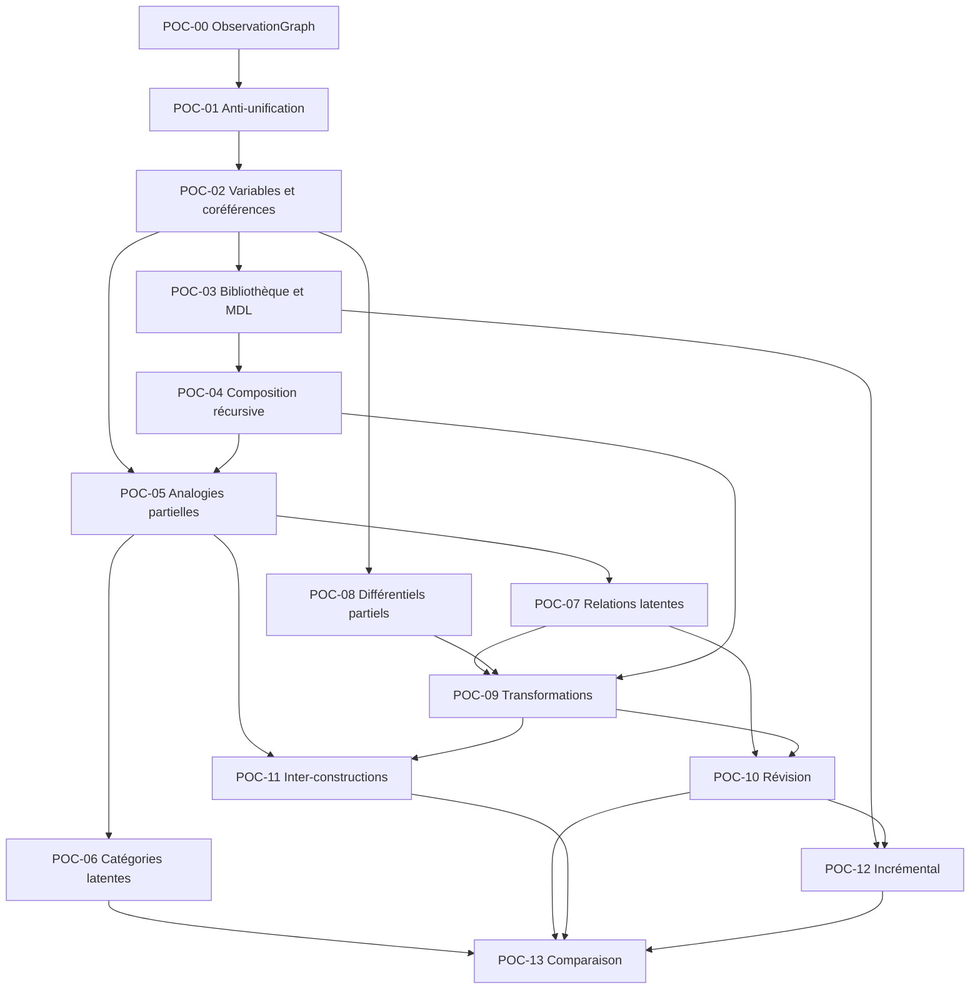

# Seman2 — Induction compositionnelle de concepts et de relations à partir de l'anglais

**Spécification de recherche et feuille de route POC**  
**Version :** 0.1 — hypothèses expérimentales, non architecture définitive  
**Date :** 8 octobre 2026  
**Statut :** document de référence autonome pour la première passe exploratoire de Seman2  
**Langue analysée :** anglais  
**Entrée initiale :** analyses du parseur grammatical de Seman2  
**Modalité d'apprentissage initiale :** ingestion de textes, sans yeux, oreilles ni capteurs  

> **Hypothèse directrice :** un système disposant de la grammaire mais d'aucune ontologie physique préalable peut découvrir des composants conceptuels réutilisables en alignant des observations linguistiques, en généralisant leurs structures, en apprenant leurs contraintes et en testant leurs conséquences. La réutilisation récursive de ces composants peut réduire la description des observations et améliorer les inférences sur de nouveaux textes. Cette hypothèse doit être **testée**, non présumée vraie.

---

## Table des matières

1. [Résumé exécutif](#1-résumé-exécutif)
2. [Origine du projet et décisions prises](#2-origine-du-projet-et-décisions-prises)
3. [Objectifs, portée et exclusions](#3-objectifs-portée-et-exclusions)
4. [Principes épistémologiques et garde-fous](#4-principes-épistémologiques-et-garde-fous)
5. [Théorie : du langage opaque aux concepts](#5-théorie--du-langage-opaque-aux-concepts)
6. [Modèle de données commun](#6-modèle-de-données-commun)
7. [Algèbre et mécanismes d'induction](#7-algèbre-et-mécanismes-dinduction)
8. [Apprentissage de l'état et des différentiels](#8-apprentissage-de-létat-et-des-différentiels)
9. [Compression compositionnelle et sélection des concepts](#9-compression-compositionnelle-et-sélection-des-concepts)
10. [Architecture provisoire et modes de fonctionnement](#10-architecture-provisoire-et-modes-de-fonctionnement)
11. [Harnais expérimental, corpus et métriques](#11-harnais-expérimental-corpus-et-métriques)
12. [Plan détaillé des quatorze POC](#12-plan-détaillé-des-quatorze-poc)
13. [Dépendances, jalons et critères de décision](#13-dépendances-jalons-et-critères-de-décision)
14. [Tests adversariaux et cas limites](#14-tests-adversariaux-et-cas-limites)
15. [Structures de dépôt et livrables](#15-structures-de-dépôt-et-livrables)
16. [Risques de recherche et questions ouvertes](#16-risques-de-recherche-et-questions-ouvertes)
17. [Bibliographie commentée](#17-bibliographie-commentée)
18. [Annexe A — jeu d'expériences minimal](#18-annexe-a--jeu-dexpériences-minimal)
19. [Annexe B — contrats formels et pseudo-code](#19-annexe-b--contrats-formels-et-pseudo-code)
20. [Annexe C — décisions à reporter aux POC](#20-annexe-c--décisions-à-reporter-aux-poc)

---

## 1. Résumé exécutif

Seman2 dispose d'un parseur grammatical anglais riche, décrit dans le projet comme couvrant approximativement **250-300 règles** avec de très bons résultats. Cette réussite fournit une matière structurée : mots, lexèmes, catégories et dépendances syntaxiques, propositions, groupes, analyses alternatives, coréférences quand elles sont disponibles et portées représentables.

La nouvelle partie étudie une question différente du parsing : **comment une machine dépourvue de perception sensorielle et de dictionnaire du monde peut-elle induire des régularités conceptuelles en lisant des textes anglais ?**

Le projet ne cherchera **pas** à coder des rôles tels que `giver`, `recipient`, `ownership`, `on_top_of`, `physical_object` ou `breakable`. Au départ, `apple`, `table`, `on`, `give` et `have` sont des symboles opaques. Même si la grammaire permet d'identifier une préposition, elle n'en fournit pas la représentation spatiale.

L'unité centrale proposée est un **`Component`** : graphe de structure, variables de substitution, contraintes, liens avec d'autres composants, preuves, contre-exemples, mesures de solidité et références aux composants utilisés. Les composants peuvent être grammaticalement simples, relationnels, événementiels, ou englober d'autres composants ; ces appellations sont des **interprétations émergentes**, et non des classes sémantiques physiques obligatoires.

Le moteur d'induction candidat réalise principalement :

- **Aligner** des graphes et leurs sous-graphes en conservant identité, dépendances, négation, portée et temporalité.
- **Abstraire** les éléments récurrents au moyen de variables et de contraintes de correspondance.
- **Composer** récursivement les composants déjà découverts.
- **Évaluer** la compression réelle, la capacité de généralisation, les contre-exemples et le coût.
- **Réviser** les hypothèses sans modifier les observations d'origine.

La compression par *Minimum Description Length* (MDL) est une piste de guidage, **pas une définition suffisante du sens** : des schémas purement syntaxiques peuvent compresser un corpus sans fournir de connaissance supplémentaire. Chaque découverte sémantique devra donc aussi contribuer à des inférences justifiées, de préférence sur des configurations inédites.

**Résultat attendu de la recherche :** verdict fondé sur des preuves concernant la viabilité de l'induction compositionnelle, ses limites, et le choix entre un moteur unique multimode ou plusieurs moteurs spécialisés. Ce document définit **14 POC**, des tests positifs/négatifs/adversariaux, des ablations et un processus de décision GO / PARTIEL / ADAPTATEUR / OUTIL / NO-GO.

## 2. Origine du projet et décisions prises

### 2.1 Point de départ

Le parseur fournit une analyse de **la forme de l'anglais**. Seman2 cherche maintenant à acquérir de façon autonome une connaissance progressive des relations entre les choses du monde décrit dans les textes, en évitant d'utiliser un LLM comme boîte noire de compréhension.

Le trajet conceptuel retenu dans les discussions est :

```text
Texte anglais
    ↓
Analyse grammaticale (déjà disponible)
    ↓
Référents candidats, connexions syntaxiques et portées
    ↓
Observations partielles d'états et de relations
    ↓
Correspondances et motifs récurrents
    ↓
Composants génériques et contraintes apprises
    ↓
Hypothèses sur les relations, changements et régularités
    ↓
Révision à l'ingestion suivante
```

Ce trajet n'implique pas qu'une seule phrase contient un « différentiel » physique, ni que tout verbe décrit une transformation.

### 2.2 Décisions d'orientation déjà établies

| Sujet | Décision de recherche |
|---|---|
| Langue | Anglais exclusivement durant cette série de POC. |
| Perception | Pas d'yeux, oreilles, images, mouvements ou données de capteurs au départ. |
| Grammaire | Les structures produites par le parseur sont accessibles, sans recopier les 265 règles dans l'inducteur. |
| Lexique | Significations lexicales et physiques initialement inconnues. |
| Prépositions | Leur classe grammaticale est connue ; leur sens spatial est **à apprendre**. |
| Logique | Noyau formel minimal autorisé, explicitement séparé de l'ontologie du monde. |
| Référents | Candidats créés à partir du discours ; ils ne sont pas automatiquement des objets physiques. |
| Transformation | Représentée comme différence entre descriptions d'états partielles, sans supposer une cause. |
| Composants | Format générique récursif plutôt que dictionnaire de rôles par verbe. |
| Moteurs | Un moteur avec plusieurs modes est l'hypothèse initiale, **non une décision irréversible**. |
| Compression | Mesurée par coût descriptif total, et confrontée à la généralisation hors échantillon. |
| Mémoire | Observations immuables ; hypothèses révisables et traçables. |
| Feuille de route | Première passe exploratoire, seconde passe de couverture, troisième passe d'intégration. |

### 2.3 Ce qui **n'est pas** décidé

Le modèle de graphe exact, le meilleur algorithme d'alignement, le seuil de promotion des composants, la forme de l'incertitude, le degré de logique initiale nécessaire, l'utilité relative de MDL et la nécessité de moteurs spécialisés doivent être arbitrés après expériences.

## 3. Objectifs, portée et exclusions

### 3.1 Objectifs fonctionnels

1. Lire une structure anglaise sans en présupposer le sens physique.
2. Découvrir des répétitions structurelles exactes puis approximatives.
3. Généraliser les répétitions avec variables et contraintes d'identité.
4. Produire des composants réutilisables et récursivement composables.
5. Apprendre des restrictions sur la substitution des variables ; faire émerger des familles de référents.
6. Découvrir des relations et correspondances entre formulations, y compris des expressions sans synonymie lexicale.
7. Comparer des descriptions d'états du monde **rapporté** dans le discours.
8. Formuler des hypothèses sur les transformations associées à certains événements.
9. Tirer des inférences justifiées et savoir s'abstenir.
10. Réviser les hypothèses, gérer l'ambiguïté et apprendre de manière incrémentale.
11. Mesurer l'apport réel de l'abstraction compositionnelle sur l'apprentissage.

### 3.2 Non-objectifs initiaux

- Reconstituer un modèle visuel 3D de l'univers.
- Prouver la vérité physique d'un énoncé textuel.
- Inventer une ontologie exhaustive de la matière, des espèces, des actions ou des sentiments.
- Remplacer immédiatement le parseur existant.
- Produire des réponses conversationnelles de niveau GPT grâce à ces seuls POC.
- « Comprendre » chaque phrase par une interprétation unique et certaine.
- Déployer directement le moteur dans le runtime de production.
- Utiliser des définitions de dictionnaires, WordNet, VerbNet, FrameNet ou un LLM pour injecter des étiquettes dans l'apprentissage. Ces ressources peuvent aider **l'évaluateur**, jamais secrètement le moteur.

### 3.3 Définition opérationnelle de « comprendre » dans ces POC

Ne pas se limiter au fait qu'un composant ressemble à une description humaine. Évaluer la capacité à **contraindre correctement les interprétations possibles**, à répondre sur de nouveaux exemples, à distinguer affirmation et hypothèse, et à admettre « informations insuffisantes ».

## 4. Principes épistémologiques et garde-fous

### 4.1 Trois niveaux à ne jamais fusionner

**Niveau O — Observation linguistique.** « Le texte présente *The apple is on the table*. » C'est une observation vérifiable du texte et du parsing, sans supposer qu'une pomme se trouve réellement quelque part.

**Niveau H — Hypothèse interprétative.** « Cette construction semble compatible avec la relation latente `R17(x,y)`. » Cette interprétation doit garder sa provenance, ses alternatives et son niveau de soutien.

**Niveau W — Modèle du monde rapporté.** « Dans ce récit, les propositions affirmées suggèrent une configuration de référents à tel moment. » Le modèle est conditionné par le locuteur, la fiction, la source et la fiabilité. Il n'est pas la réalité indépendante de toute source.

Un texte fictif peut être cohérent, instructif et pourtant faux du monde physique. Une affirmation rapportée peut être fausse ; une question ou un conditionnel ne doit pas devenir un fait accepté.

### 4.2 Monde ouvert et observations partielles

- Inconnu ≠ faux.
- Non observé ≠ inchangé.
- Suite temporelle ≠ causalité.
- Cooccurrence ≠ implication.
- Similarité de signatures ≠ équivalence.
- Présence du même nom ≠ identité du référent.
- Sujet grammatical ≠ agent qui agit.
- Objet grammatical ≠ patient qui subit.
- Participation à un événement ≠ changement de propriétés.
- Fréquence d'une formulation ≠ vérité scientifique.

### 4.3 Règle de non-contamination sémantique

Toute information mise à disposition du moteur doit être classée dans une **liste blanche** et une **liste interdite**.

**Liste blanche initiale :** tokens et lexèmes anglais opaques ; catégories grammaticales ; ordre des mots ; dépendances et structure hiérarchique ; relations de portée **quand justifiées par le parseur** ; liens d'identité de mentions avec degrés d'incertitude ; connecteurs discursifs identifiés formellement ; contraintes logiques élémentaires choisies et documentées ; liens temporels explicitement présents ou résolus par une procédure formelle distincte.

**Interdit comme donnée d'entrée initiale :** prédicats `POSSESSION`, `SUPPORT`, `CONTACT`, `CONTAINMENT`, `TRANSFER`, `AGENT`, `RECIPIENT`, `FOOD`, `ANIMAL`, `PHYSICAL_OBJECT`, définitions lexicales, voisinages d'embeddings sémantiques externes, paraphrases générées et annotations de rôles sémantiques.

Un oracle de test peut posséder ces étiquettes **hors du processus d'apprentissage**, pour calculer les réponses correctes.

### 4.4 Limite d'identifiabilité

Un système purement textuel peut apprendre un réseau très puissant de contraintes relationnelles et logiques ; il ne peut garantir l'unique interprétation physique externe de ses symboles. Plusieurs modèles du monde peuvent être compatibles avec exactement les mêmes phrases. Le protocole doit mesurer les capacités inférentielles et les limites, pas prétendre résoudre magiquement l'ancrage sensoriel.

## 5. Théorie : du langage opaque aux concepts

### 5.1 La première phrase : aucune image spatiale

Entrée :

> The apple is on the table.

Analyse approximative, simplifiée pour l'illustration :

```text
CLAUSE
├── NP/SUBJECT
│   ├── DET(the)
│   └── NOUN(apple)
└── PREDICATE
    ├── COPULA(is)
    └── PP
        ├── PREP(on)
        └── NP
            ├── DET(the)
            └── NOUN(table)
```

Ce qui est connu : `apple` occupe une tête nominale dans une mention ; `table` aussi ; `on` a une fonction syntaxique prépositionnelle dans un groupe prédicatif ; leurs positions et dépendances sont observées.

Ce qui n'est pas connu : si ces termes désignent des objets, si `on` signifie contact, support ou une relation abstraite, si une propriété a changé, si l'assertion est vraie dans la réalité.

Le moteur peut, **comme hypothèse de travail et non comme fait physique**, créer :

```text
Mention m1: lexical_anchor(apple)
Mention m2: lexical_anchor(table)
Pattern p1: PP(on, m2) predicated_about m1
Candidate R_on(x1, x2)  // R_on n'est qu'une étiquette opaque
```

Il est permis de ne **pas** créer `R_on` lors du POC 00 et d'attendre qu'un inducteur découvre une façon utile de factoriser cette structure. Ne pas confondre la notation pédagogique avec une extraction sémantique validée.

### 5.2 La connaissance émerge des contraintes entre occurrences

Corpus illustratif :

```text
The apple is on the table.
The book is on the desk.
The cat is on the chair.
The apple was on the table. Now it is under the table.
The apple fell off the table.
The book is beneath the desk.
```

Premières régularités possibles : une construction revient avec plusieurs paires de mentions ; d'autres constructions réemploient les mêmes mentions ; certains récits présentent des descriptions successives ; des négations expriment explicitement un désaccord avec certaines formulations.

Ces régularités **ne prouvent pas** que `under` est l'opposé de `on`, que `on` implique `above` ou que `fall` implique toujours un changement spatial. Elles offrent seulement des hypothèses à tester par comparaison, reformulation, contre-exemple et inférence.

### 5.3 De la répétition aux concepts

Trois phrases :

```text
The apple is on the table.
The book is on the desk.
The cat is on the chair.
```

Abstraction de niveau initial :

```text
C42 := CLAUSE(NP(the, X), PREDICATE(is, PP(on, NP(the, Y))))
```

`X` et `Y` sont des **variables de substitution**, pas des concepts physiques. Elles peuvent plus tard recevoir des contraintes apprises : compatibilité avec certains lexèmes, composants, schémas de coréférence, contextes, etc.

Puis l'induction peut produire une forme plus générale :

```text
C187 := CLAUSE(NP(X), PREDICATE(V, PP(P, NP(Y))))
```

C187 couvre plus de phrases mais préserve moins d'information. Les deux composants peuvent coexister ; un parent général ne doit pas supprimer un enfant spécifique utile.

### 5.4 La signification comme profil de contraintes

Un lexème n'est pas obligé de posséder une « définition en français ». Son profil pourrait comprendre :

- les structures grammaticales où il apparaît ;
- les types de référents et de composants auxquels il se relie ;
- les conséquences conditionnelles régulièrement corroborées ;
- ses incompatibilités locales et contre-exemples ;
- les reformulations ou inversions soutenues par le corpus ;
- les transitions d'états parfois associées ;
- les restrictions contextuelles de ses différentes lectures ;
- les incertitudes et hypothèses concurrentes.

Ce profil peut être un **réseau de composants**, plutôt qu'une entrée de dictionnaire isolée. Des composants émergents peuvent ne correspondre à **aucun mot anglais unique**.

### 5.5 Trois familles émergentes, pas nécessairement trois moteurs

Les structures de connaissance candidates comprennent :

1. **Familles de référents** : motifs de propriétés et de relations compatibles avec certaines substitutions.
2. **Relations** : configurations entre deux ou plusieurs positions, parfois négociées ou réinterprétées selon les contextes.
3. **Transformations** : motifs reliant des descriptions de configurations ordonnées dans le récit.

La même opération d'alignement-abstraction-composition pourrait les apprendre. La séparation en moteurs spécialisés sera jugée expérimentalement dans le POC 13.

### 5.6 Les mots-outils et le noyau formel

La **classe grammaticale** d'un mot-outil peut être connue sans que sa **signification lexicale** le soit. Les prépositions anglaises (*on*, *in*, *over*, *under*, *off*, etc.) doivent pouvoir rester opaques. Certaines ont des usages spatiaux et d'autres non : *on the table*, *on the phone*, *on Monday*, *on fire*.

La logique formelle est une autre question : si Seman2 possède un opérateur abstrait de négation, ce choix de langage interne ne signifie pas qu'il possède le concept physique de « dessous ». Il faudra enregistrer explicitement la correspondance entre construction anglaise et opérateur formel, et tester les ambiguïtés de portée.

**Politique POC recommandée :** définir les opérations de représentation minimales (variables, identité, égalité, polarité, liens ordonnés, modalités d'assertion, portées) mais **ne pas** prédéfinir les relations physiques ou les rôles lexicaux. Consigner chaque privilège accordé au système.

## 6. Modèle de données commun

### 6.1 Observations et composants sont distincts

- `Observation` : résultat immuable de l'ingestion d'un passage, comprenant la source, le texte, les analyses et leurs alternatives.
- `Component` : hypothèse d'abstraction structurale potentiellement réutilisable, ajustable et versionnée.
- `Hypothesis` : proposition candidate concernant une relation, une implication, une transition, une contrainte ou une analogie.
- `Episode` / `DiscourseContext` : ensemble de mentions, de propositions, de portées et de relations temporelles associées à un texte ou récit.
- `EvidenceLink` : attachement explicite entre une hypothèse et ses appuis/contradictions avec provenance.

Tous peuvent reposer sur un graphe commun, mais **leurs statuts épistémiques restent distincts**.

### 6.2 Graphe d'observation

Utiliser un **graphe dirigé, typé sur le plan structurel**, avec arêtes étiquetées et, si nécessaire, hyperarêtes ordonnées. La typologie minimale porte sur la syntaxe et l'encodage, pas sur les catégories physiques du monde.

Nœuds candidats : token/lexème, groupe, proposition, mention, référent candidat, occurrence de construction, opérateur logique, ancre d'événement décrite, variante d'analyse. Chaque nœud reste lié au segment de texte d'origine et à la version du parseur.

Arêtes candidates : dépendance, appartenance, ordre syntaxique, identité référentielle candidate, ordre temporel relatif explicite, domination de portée, négation, appui documentaire et référence à un composant.

**Important :** un « nœud d'événement » est d'abord une **occurrence grammaticale décrite**, pas un acte physique reconnu. Les liens de temps sont entre événements, états, observations et contextes ; les horodatages absolus, s'ils figurent dans une source, restent des ancrages externes séparés.

### 6.3 `Component` — contrat conceptuel

```text
Component {
    id               // identifiant stable
    version          // évolution, audit et invalidation
    structure        // graphe ou hypergraphe interne
    variables        // ports de substitution, réemploi et égalité
    constraints      // conditions formelles de correspondance
    relations        // liens vers les autres composants
    evidence         // références aux observations qui soutiennent
    exceptions       // contre-exemples, domaines invalides, réserves
    confidence       // soutien calibré, pas « vérité » absolue
    composition      // composants réutilisés et liaisons des ports
    status           // candidate / tested / validated / retired
}
```

Ne pas imposer les classes `EntityComponent`, `RelationComponent`, `EventComponent`. Si des **vues spécialisées** sont utiles (relations, transformations), elles ne doivent pas dicter une ontologie cachée au cœur du format.

### 6.4 Nature des variables

| Variable | Remplace | Exemple |
|---|---|---|
| Lexicale | Un lexème ou token dans un site grammatical | `X := apple` ou `book` |
| Syntagmatique | Un sous-arbre ou sous-graphe | `NP(X)` ou proposition complète |
| Référentielle | Une identité dans le discours | `x17` pour *the apple* / *it* |
| Relationnelle | Un sous-graphe relationnel inconnu | `R?(x,y)` |
| Compositionnelle | Une instance d'un composant | `C42(X,Y)` |

Une même variable répétée impose une **contrainte d'identité** ; deux variables différentes n'impliquent pas forcément deux individus distincts, sauf si une contrainte explicite le demande. Les types admissibles doivent être **structurels**, ou **appris** par induction, pas physiques et hardcodés.

### 6.5 Exemple : coréférence et mention

> John put the apple on the table. He picked it up.

```text
mention m1: John
mention m2: the apple
mention m3: the table
mention m4: He
mention m5: it

candidate_coreference(m4, m1)
candidate_coreference(m5, m2)
```

`m2` et `m5` sont deux expressions distinctes. Le même référent *hypothétique* peut leur être associé. Si la coréférence est incertaine, maintenir plusieurs analyses plutôt que d'imposer une identité.

### 6.6 Confiance et traces

Ne pas stocker uniquement `confidence = 0.93` sans provenance. Conserver, au minimum :

- nombre et diversité des preuves ;
- nombre et nature des contre-exemples ;
- taux de couverture ;
- coût descriptif / gain de compression ;
- précision ou calibration hors échantillon ;
- qualité des analyses sources ;
- distinction observation / hypothèse / conclusion déduite ;
- domaine/contextes où l'hypothèse a été validée.

Un score agrégé est optionnel ; les preuves doivent rester inspectables et permettre de recalculer le score après retrait ou correction d'une source.

### 6.7 Composition et identité des composants

- Référencement par identifiant/version, pas copie profonde systématique.
- Graphe de composition **acyclique par défaut pour la décomposition matérielle** ; des récurrences peuvent exister dans les relations sémantiques entre composants sans créer une expansion récursive infinie.
- Canonicalisation des graphes sous renommage de variables, respectant identité, polarité, portée et ordre des arguments.
- Deux composants ne sont fusionnables que si leur **équivalence structurale sous contraintes** est établie ; ressemblance de traits ≠ identité.
- Une promotion, scission ou retraite ne supprime jamais les références aux observations brutes.

### 6.8 Représentation sérialisable illustratrice

```yaml
id: C0042
version: 1
status: candidate
structure:
  root: clause_1
  nodes:
    - {id: clause_1, kind: CLAUSE}
    - {id: n1, kind: NP}
    - {id: n2, kind: PP}
    - {id: v1, kind: LEXICAL_ANCHOR, value: "on"}
  edges:
    - {from: clause_1, to: n1, role: subject}
    - {from: clause_1, to: n2, role: predicate_pp}
    - {from: n2, to: v1, role: head}
variables:
  - {id: X, accepts: NP_HEAD, occurrences: [n1]}
  - {id: Y, accepts: NP_HEAD, occurrences: [n2.object]}
constraints:
  - {kind: binding_consistency, vars: [X, Y]}
relations: []
evidence:
  - {observation_id: O0001, alignment_id: A0001}
  - {observation_id: O0002, alignment_id: A0002}
exceptions: []
confidence:
  support: 2
  heldout_evaluation: null
composition: []
```

Ce YAML est **conceptuel** : `n2.object` doit être remplacé en implémentation par un vrai chemin de port résolu, et `binding_consistency` n'affirme **pas** `X != Y`. Ce n'est ni une API figée ni une prétendue extraction sémantique de *on*.

---
## 7. Algèbre et mécanismes d'induction

### 7.1 Hypothèse : un mécanisme commun, plusieurs opérateurs

La théorie candidat n'est pas « un classifieur par rôle sémantique ». Elle recherche des opérations réutilisables sur des graphes :

1. **Repérer** : indexer les régions potentiellement comparables.
2. **Aligner** : établir une correspondance partielle entre nœuds/arêtes de plusieurs graphes.
3. **Abstraire** : produire le motif commun avec variables, liaisons et résidus.
4. **Contraindre** : inférer les conditions de substitution corroborées.
5. **Composer** : remplacer des sous-graphes par des références à des composants plus petits.
6. **Comparer** : confronter composant et nouvelles occurrences, noter support/résidu/contre-exemple.
7. **Réviser** : spécialiser, diviser, relâcher, retirer ou maintenir les hypothèses.

Les modes d'analyse ne sont pas nécessairement des moteurs distincts : motif statique, série temporelle, inversion d'arguments, changement de polarité, reformulation ou abstraction entre abstractions.

### 7.2 Opérateur d'alignement

Soient deux graphes d'observation `G1`, `G2`. Un alignement `A` associe certains nœuds et certaines relations de `G1` à leurs correspondants de `G2` en respectant des contraintes formelles.

```text
A = align(G1, G2, constraints)
A.mapping       : correspondances entre nœuds
A.shared_edges  : relations communes
A.residual_1    : ce qui n'est pas expliqué dans G1
A.residual_2    : ce qui n'est pas expliqué dans G2
A.cost          : score de correspondance / coût d'encodage
A.ambiguities   : alignements alternatifs crédibles
```

L'alignement doit préserver les rôles grammaticaux, les contraintes de liaison, les dominances de portée et les opérateurs logiques **dans la mesure où ces propriétés sont présentes dans l'observation**. Une ressemblance lexicale ne donne pas le droit d'écraser une négation ou d'inverser arbitrairement des arguments.

**Cas trivial de validation :** `f(a, g(a,b))` et `f(c, g(c,d))` ont comme généralisation classique `f(X, g(X,Y))`. La répétition de `X` est essentielle. Pour les graphes, le correspondant exige un traitement explicite de la topologie, des arêtes et des cycles, non la réutilisation naïve d'un algorithme d'arbres.

### 7.3 Généralisation / anti-unification

Dans une représentation de termes classique, la généralisation la moins générale (*least general generalization*, lgg) capture exactement l'invariant compatible avec les deux observations. Pour Seman2, l'objectif est une **anti-unification de graphes contraints**.

```text
G1: NP(the, apple) + PP(on, NP(the, table))
G2: NP(the, book)  + PP(on, NP(the, desk))

lgg(G1,G2) ≈ NP(the, X) + PP(on, NP(the, Y))
```

Une transformation telle que `NP(the, apple)` vers `NP(a, book)` peut susciter différents compromis : varier seulement le nom, varier le déterminant et le nom, ou faire d'un sous-groupe entier une variable. Les généralisations candidates doivent être évaluées par le **coût d'encodage** et par leur utilité sur de nouveaux cas ; ne pas choisir automatiquement l'abstraction la plus large.

### 7.4 Matching approximatif et analogie

Les correspondances exactes ne suffiront pas pour comparer :

```text
John gave Mary the key.
The key was given to Mary by John.
Mary received the key from John.
```

La première et la deuxième peuvent être rapprochées par des transformations grammaticales reconnues, mais la troisième demande un apprentissage lexical supplémentaire. Une abstraction qui déclare *receive* équivalent à *give* sur simple fréquence aurait échoué.

Le moteur doit explorer des correspondances partielles : sous-graphes communs, arguments réordonnés **avec preuve**, élisions, adjonctions, propositions multiples, anaphores et reformulations. Les « inversions » doivent être **des hypothèses observables**, jamais un privilège accordé manuellement à *give/receive*.

### 7.5 Découverte de contraintes sur les variables

Lorsqu'un composant `C(X,Y)` se répète, le système peut examiner quelles substitutions sont compatibles avec les exemples connus. Types de contraintes candidats :

- égalité ou distinction entre points de liaison ;
- arité et ordre des arguments ;
- contraintes de portée et de polarité ;
- exigences syntaxiques déjà fournies par le parseur ;
- incompatibilités entre motifs sous certaines conditions ;
- compatibilité avec d'autres composants découverts ;
- contraintes de contexte, de source ou de domaine ;
- restrictions apprises par un motif d'occurrences et d'échecs.

**Prudence :** « jamais observé avec X » n'est pas une contrainte négative démontrée. Le système doit différencier les impossibilités logiques, les négations explicites et la rareté empirique.

### 7.6 Catégories émergentes de référents

Des mots comme `apple`, `book`, `cat`, `table`, `desk`, `chair` peuvent partager une partie de leurs signatures relationnelles sans appartenir à la même classe physique. Les catégories latentes doivent :

1. provenir de signatures ou graphes observés ;
2. avoir des critères d'appartenance testables ;
3. permettre le chevauchement et plusieurs granularités ;
4. être révisables si une nouvelle observation exige une scission ;
5. apporter une généralisation distincte de la simple classe grammaticale `NOUN`.

Exemple : `C_T7(X)` peut être défini par un réseau de relations avec plusieurs autres composants. Ne pas le baptiser « objet solide » tant qu'une justification externe ou un protocole sémantique ne le permet pas.

### 7.7 Hypothèses entre relations : pas seulement les synonymes

Pour des relations candidates `R1` et `R2`, l'espace des hypothèses peut comprendre :

```text
EQUIV_CANDIDATE: R1(x,y) <=> R2(x,y)
INVERSE_CANDIDATE: R1(x,y) <=> R2(y,x)
IMPLIES_CANDIDATE: R1(x,y) => R2(x,y)
INCOMPATIBLE_CANDIDATE: not (R1(x,y) and R2(x,y))  [contexte fixé]
TRANSITION_CANDIDATE: R1(x,y) --T--> R2(x,y)
```

Le mot `CANDIDATE` est obligatoire tant que le statut logique n'est pas établi. Les équivalences doivent résister à des contre-exemples ; une implication n'est pas symétrique. Les incompatibilités nécessitent un domaine et, généralement, un contexte temporel et épistémique partagé.

### 7.8 Polysémie et composition

L'unité de découverte ne doit pas être simplement « un sens global par mot ». `on` est susceptible d'être associé à plusieurs familles de contraintes, par exemple des usages très différents de *on the table*, *on the phone*, *on Monday* et *on fire*. Les familles peuvent être apprises selon des structures environnantes, d'autres lexèmes opaques et des catégories émergentes d'arguments.

L'algorithme doit permettre :

- plusieurs interprétations d'une même occurrence ;
- plusieurs composants associés à un même lexème ;
- des spécialisations par construction ou contexte ;
- des hypothèses qu'un même noyau abstrait est partagé, sans obliger la fusion.

### 7.9 Révision des abstractions

Un composant peut être :

- **conservé** si les nouvelles observations soutiennent son domaine ;
- **spécialisé** par ajout d'une condition ;
- **scindé** en variantes compatibles avec différents contextes ;
- **affaibli** si une implication n'est plus soutenue ;
- **rétrogradé** à un motif lexical, sans statut sémantique ;
- **retiré** des prédictions tout en préservant son historique.

Une seule phrase contradictoire peut réfuter une implication logique universelle **dans un cadre supposé fiable et cohérent** ; elle ne doit pas nécessairement annuler une régularité probabiliste ni primer sur des sources concurrentes dans le monde réel.

## 8. Apprentissage de l'état et des différentiels

### 8.1 Distinction cruciale : l'état du monde décrit et l'état informationnel

Lire « The apple is on the table » modifie d'abord la **mémoire des énoncés observés**. Cela ne signifie ni qu'une pomme vient de bouger, ni qu'une pomme existe réellement.

```text
KnowledgeState_0 → [lecture d'un énoncé] → KnowledgeState_1
WorldState_before → ?                         → WorldState_after ?
```

Le premier différentiel peut être enregistré avec certitude (le système a reçu un nouvel énoncé). Le second reste inconnu sans descriptions suffisantes, et sa fiabilité dépend des sources.

### 8.2 Graphe d'état partiel

Soit `G_t` une représentation des relations **rapportées** à une position ou phase temporelle relative du récit. `G_t` n'est ni complet ni nécessairement vrai de la réalité.

```text
G_t = {
    propositions textuellement soutenues,
    liens entre référents candidats,
    polarité, source et portée,
    relations temporelles relatives,
    éléments explicitement inconnus
}
```

Le différentiel pertinent est :

```text
Delta(G_a, G_b) = {
    added_assertions,
    removed_or_negated_assertions_if_explicit,
    changed_bindings_if_supported,
    maintained_links_if_proven,
    unknown_or_unresolved
}
```

La disparition d'une relation du texte à `b` n'implique **pas** sa disparition du monde ; `removed_or_negated` demande une négation ou un changement explicite valide. Les comparaisons se font entre états descriptifs partiels compatibles en référents, sources, contextes et portée.

### 8.3 Nombre indéterminé de participants affectés

Dans « John destroyed the bridge », le sujet et l'objet constituent deux arguments syntaxiques, mais l'événement décrit peut affecter un nombre inconnu de personnes ou relations indirectes. On ne crée pas tous ces participants sans observation ni inférence valide.

On suit un **différentiel de graphe global**, puis on peut le projeter sur une entité :

```text
Delta_global = diff(G_before, G_after)
Delta(x) = edges_in_Delta_global_incident_to(x)
```

Cette projection n'est pas une liste hardcodée de « subissants ». Le graphe est extensible et les participants non observés restent indéterminés.

### 8.4 Temporalité purement relationnelle

Représenter les relations entre événements, états, contextes, observations et transmissions ; une date absolue citée par la source est un attribut d'ancrage, pas le modèle temporel fondamental.

Exemples : `before(e1,e2)`, `overlaps(s1,e2)`, `during(s1,s2)`, relations ambiguës entre intervalles. Ne pas inventer une succession réelle lorsque la phrase ne contient qu'une succession de mentions. Une narration peut revenir dans le passé ou décrire des événements imaginés.

### 8.5 Première série de transformations potentielles

```text
John had a key.
John gave the key to Mary.
Mary had the key.
```

Ce qu'on peut observer : deux formulations de `had` avec arguments différents, encadrant une construction `gave` dans l'ordre du récit. On peut induire **un motif de co-occurrence séquentielle**. Sans règles lexicales physiques, on ne peut pas conclure que John a définitivement perdu la clé, que Mary en est propriétaire ou que l'événement intermédiaire cause nécessairement le changement.

On cherchera progressivement les variantes, contre-exemples, négations et reformulations. Une forme candidate :

```text
C_transfer_like  // nom de débogage humain, pas étiquette disponible au moteur
  observed_before: R_a(X, Z)
  intervening_pattern: E_b(X, Z, Y)  // ordre exact selon l'analyse réelle
  observed_after: R_a(Y, Z)
  qualifiers: source, timeline, uncertainty, context
```

### 8.6 Changements suggérés et changements non attestés

- `John saw Mary.` : participation de Mary sans changement observé obligatoire.
- `John owns a house.` : description stative, pas preuve d'acquisition.
- `John bought a house.` : événement verbal dont les conséquences doivent être apprises.
- `John wants a house.` : état intentionnel, sans possession affirmée.
- `John imagines buying a house.` : événement imaginé, pas achat factuel.
- `The glass fell.` : ne permet pas de conclure que le verre s'est brisé.

Les opérateurs de négation, condition, modalité, interrogation et attribution à une source doivent empêcher la promotion de conclusions non affirmées.

## 9. Compression compositionnelle et sélection des concepts

### 9.1 Objectif MDL

Le principe *Minimum Description Length* propose de chercher une description compacte des données en tenant compte du coût de la théorie elle-même. Pour une bibliothèque `M` et des observations `D` :

\[
L_{total}(M,D) = L(M) + L(D\mid M)
\]

Pour Seman2, `L(D|M)` doit inclure les références à des composants, les valeurs des variables, le coût des alignements, les résidus, les exceptions et tout ce qui est nécessaire pour reconstruire les observations. Ne pas compter une seule fois le composant et oublier le prix de ses instanciations.

### 9.2 Compression sans perte et compression prédictive

**Niveau A — Fidélité.** Les observations et analyses originales restent reconstructibles exactement (ou conservées intégralement en parallèle). C'est une exigence d'intégrité.

**Niveau B — Qualité du modèle.** Sur un corpus tenu à l'écart, la bibliothèque minimise réellement le coût descriptif sans compter l'apprentissage des données de test.

**Niveau C — Valeur conceptuelle.** Les abstractions améliorent les prédictions de relations, reformulations ou transitions justifiées au-delà d'un modèle qui ne voit que les répétitions grammaticales.

Une économie de 60 % sur un exemple pédagogique n'est **pas** un résultat empirique. Les pourcentages réels proviendront des benchmarks reproductibles.

### 9.3 Sur-généralisation et sous-généralisation

```text
C_any(x,y) = R(x,y)
```

Peut devenir un modèle extrêmement général mais vide de contraintes utiles. À l'inverse, recopier chaque occurrence exacte ne crée pas de réutilisation.

Le score d'un candidat peut être défini, pour l'exploration, comme un vecteur :

```text
CandidateEvaluation {
  mdl_gain_on_training,
  mdl_gain_on_heldout,
  inference_gain_on_heldout,
  complexity_cost,
  contradictions,
  runtime_cost,
  evidence_diversity
}
```

La promotion peut utiliser des critères lexicographiques ou des seuils de Pareto plutôt qu'un score scalaire mal calibré. Ne pas mélanger arbitrairement « 1 bit gagné » et « 1 % de précision » sans politique explicite.

### 9.4 Compression hiérarchique

Une bibliothèque peut passer de :

```text
raw observations → C1, C2 → C3(C1,C2) → C4(C3,C1)
```

Les composants peuvent porter des contraintes sur la manière dont leurs ports sont unifiés. Une bibliothèque efficace doit éviter : copies de graphes à répétition, explosion combinatoire d'abstractions, collisions sous renumérotation de variables et cycles d'expansion non terminants.

### 9.5 Évaluation par ablation

Pour démontrer que la composition contribue à la connaissance, mesurer au minimum :

1. Parseur + indexations / motifs exacts, sans abstraction.
2. Anti-unification sans composition récursive.
3. Anti-unification + composition, sans MDL.
4. Composition + MDL, sans apprentissage des contraintes.
5. Système complet, avec révision.

Si l'ablation de la composition n'affecte pas les inférences sur des cas nouveaux, son rôle cognitif n'est pas démontré, même si elle économise de la mémoire.

## 10. Architecture provisoire et modes de fonctionnement

### 10.1 Pipeline logique

```text
                    ┌───────────────────────────┐
Texte anglais ──────▶│ Parseur Seman2 existant   │
                    └────────────┬──────────────┘
                                 │ analyses alternatives
                                 ▼
                    ┌───────────────────────────┐
                    │ ObservationStore immuable │
                    │ + provenance / parser ver.│
                    └────────────┬──────────────┘
                                 │
                                 ▼
                    ┌───────────────────────────┐
                    │ ObservationGraph adapter  │
                    └────────────┬──────────────┘
                                 │
                                 ▼
                    ┌───────────────────────────┐
                    │ InductionEngine           │
                    │ align / abstract / compose│
                    │ constrain / revise        │
                    └────────────┬──────────────┘
                                 │
                   ┌─────────────┴─────────────┐
                   ▼                           ▼
           ┌──────────────────┐       ┌───────────────────┐
           │ ComponentLibrary │◀─────▶│ HypothesisStore   │
           └────────┬─────────┘       └────────┬──────────┘
                    └─────────────┬────────────┘
                                  ▼
                        ┌────────────────┐
                        │ Evaluator      │
                        │ MDL / inference│
                        │ counterexamples│
                        └────────────────┘
```

### 10.2 Un seul format de composants, plusieurs chemins de recherche

Modes candidats :

- **S0 — Matching rapide** : motifs exacts ou presque exacts sur index structurel.
- **S1 — Anti-unification** : généralisation de paires/groupes de graphes.
- **S2 — Assemblage** : recherche de composés à partir de composants existants.
- **S3 — Alignement inter-phrases** : identité des référents, séquences, portées, temporalité.
- **S4 — Contraintes** : candidats d'équivalence, d'implication et d'incompatibilité.
- **S5 — Révision** : invalidation, scission, consolidation et compression globale.

Aucun mode n'a le droit d'introduire implicitement `giver`, `recipient`, etc. Les modes peuvent différer par l'heuristique de recherche et les structures ciblées, pas par une ontologie injectée.

### 10.3 Ingestion rapide et consolidation

Ne pas comparer chaque nouvelle phrase à tous les graphes précédents. Proposer :

- normaliser et stocker l'observation ;
- utiliser des signatures indexables peu coûteuses (formes grammaticales, tailles, sous-graphes, empreintes invariantes sous renommage) ;
- limiter la génération de candidats aux voisinages plausibles ;
- mettre en cache les alignements reproductibles ;
- conserver une file de candidats à évaluer ;
- réaliser les recherches analogiques et les révisions plus coûteuses lors de consolidations explicitement lancées.

Il ne s'agit pas d'une promesse d'exécution en arrière-plan par ChatGPT : c'est un **comportement logiciel envisagé pour Seman2**, à implémenter et mesurer.

### 10.4 Dépendances avec les autres modules Seman2

- **Parseur** : contrat d'export versionné et tests de fidélité ; ne pas modifier ses 265 règles pour satisfaire artificiellement les POC inductifs.
- **Coréférence** : fournir liens candidats et degré d'incertitude ; ne pas exiger l'oracle parfait sauf dans un benchmark diagnostique.
- **Temps** : conserver les relations relatives entre états, événements, observations et contextes ; éviter les timestamps fictifs.
- **Lexique** : préserver identifiants opaques ; toute connaissance importée doit être signalée par le protocole expérimental.
- **Mémoire / raisonnement** : distinguer observations, hypothèses et déductions ; rendre chaque inférence retraçable.

## 11. Harnais expérimental, corpus et métriques

### 11.1 Corpus nécessaires

**Corpus S — Syntaxe synthétique.** Phrases anglaises générées à partir de motifs grammaticaux connus, lexèmes opaques (par ex. `glurp`, `bvvbvv`), variations d'ordre, propositions imbriquées, transformations actives/passives et ambiguïtés. But : isoler l'abstraction des connaissances lexicales.

**Corpus W — Monde synthétique caché.** Un générateur possède un ensemble de référents, relations et transitions **privés** et produit des récits anglais. Seman2 ne reçoit que les textes et les sorties autorisées du parseur. L'oracle garde la vérité des états, les types cachés et les relations attendues. But : mesurer ce qui peut être redécouvert sans perception.

**Corpus N — Anglais naturel contrôlé.** Textes anglais réels ou rédigés, sélectionnés pour des phénomènes : anaphores, négations, modaux, discours rapporté, prépositions polysémiques, conditions, comparaisons et enchaînements d'événements. But : tester le transfert hors des mondes artificiels. Étiquettes d'évaluation établies séparément ; conserver un taux d'accord humain si possible.

**Corpus H — Cas hostiles.** Contradictions, pièges syntaxiques, anti-correlations, transformations trompeuses, sources multiples, récits fictifs, pièges d'ordre temporel, homonymies et exemples impossibles à trancher.

### 11.2 Division des données : éviter les fuites

Distinguer :

- partage aléatoire de phrases (facile mais insuffisant) ;
- partage par **familles de constructions** et par modèles générateurs ;
- partage par **combinaisons de référents et relations** ;
- partage par lexèmes (nouveaux lexèmes au test) ;
- partage par **structures composées** jamais rencontrées ;
- partage par **mondes cachés** différents ;
- perturbation de fréquence (décorréler cooccurrence et relation réelle).

Une phrase de test paraphrasant littéralement un exemple d'entraînement ne constitue pas une généralisation forte. Figer des seeds, conserver les générateurs versionnés et assurer que l'oracle ne fuit pas par les noms de fichiers, de fonctions ou les étiquettes du parseur.

### 11.3 Familles d'épreuves minimales par POC

| Type | Exigence |
|---|---|
| Positive | L'opération doit réussir dans un cas représentatif. |
| Négative | Une similarité superficielle ne doit pas provoquer une fusion incorrecte. |
| Adversariale | Tester ambiguïté, portée, négation, coréférence, contexte et contradictions. |
| Hors distribution | Nouveaux lexèmes, graphes et combinaisons. |
| Ablation | Désactiver le mécanisme central pour mesurer sa contribution. |
| Coût | Mesurer temps et mémoire, pas seulement exactitude. |

### 11.4 Mesures communes

- **Losslessness** : taux de reconstruction exacte des observations (cible structurelle : **100 %** dans le périmètre déclaré).
- **Alignement** : précision/rappel des correspondances d'oracle et conservation des contraintes de liaison.
- **Compression** : taille du modèle + encodage du corpus + exceptions/résidus ; comparer avec mêmes conventions d'encodage.
- **Compression held-out** : longueur de description de textes nouveaux avec bibliothèque gelée.
- **Réutilisation** : part des observations nouvelles encodées avec les composants découverts et coût marginal associé.
- **Prédiction relationnelle** : précision, rappel, abstention, calibration et erreur par niveau de preuve.
- **Prédiction de transition** : exactitude des changements **affirmés** et absence d'hallucination sur les changements inconnus.
- **Révision** : capacité à intégrer les contre-exemples sans perte irrécupérable des faits sources.
- **Stabilité** : variation selon l'ordre d'ingestion, les seeds et les paraphrases.
- **Ressources** : latence p50/p95/p99, mémoire maximale, nombre de candidats et temps de consolidation.

### 11.5 Seuils

**Seul seuil structurel proposé dès le départ : reconstruction exacte à 100 %**, sous réserve que le format d'observation permette cette exigence. Les nombres `10 % de compression`, `85 % de généralisation` ou `95 % de précision` évoqués en conversation sont **des cibles illustratives à calibrer**, pas des verdicts pré-approuvés. Pour chaque POC, les seuils de performance et de précision doivent être fixés **avant** la dernière exécution d'évaluation, à partir d'un pilote et de baselines.

### 11.6 Baselines exigées

- `B0`: données du parseur et motifs exacts uniquement ;
- `B1`: signatures de fréquence/cooccurrence sans graphes compositionnels ;
- `B2`: anti-unification sans bibliothèque récursive ;
- `B3`: bibliothèque compressive sans hypothèses relationnelles ;
- `B4`: pipeline complet, mais sans MDL ;
- `B5`: pipeline complet, mais sans révision ;
- optionnel : outil externe de référence, sans contamination par des étiquettes sémantiques interdites.

L'objectif est de montrer que l'induction produit un **gain explicatif spécifique** et non seulement qu'elle exploite le volume de texte.

---
## 12. Plan détaillé des quatorze POC

> Convention : `POC-00` à `POC-13` forment **14 expériences**, réparties en cinq phases. Tous produisent un verdict, des mesures reproductibles, des observations négatives et une fiche de couverture. Aucun résultat n'est présumé GO.

### PHASE A — Fondations structurelles

#### POC-00 — Graphe universel d'observation

**Hypothèse.** Les sorties du parseur existant peuvent être converties en un graphe d'observation canonique **sans perdre d'information pertinente** et sans introduire d'étiquettes sémantiques physiques.

**Entrées.** Analyses du parseur anglais : simples SVO/SV, copule + PP, coordination, subordination, interrogations, négation, groupes complexes, relatives, coréférence candidate, ambiguïtés et phrases multi-propositions.

**Travail.** Spécifier les nœuds/arêtes structurels, la représentation d'alternatives, les positions de tokens, les spans, les scopes, les identifiants et la sérialisation. Implémenter conversion puis reconstruction ; conserver le parse brut si le modèle normalisé simplifie certaines propriétés.

**Tests positifs.** Round-trip `parse → graph → parse-equivalent` sur cas représentatifs ; préservation des multiples analyses distinctes ; liens de coréférence marqués comme certains ou candidats.

**Tests négatifs/adversariaux.** Une négation déplacée, une portée différente, un groupe enchâssé ou deux coréférences concurrentes doivent produire des graphes distincts. Un simple changement d'identifiants artificiels ne doit pas changer la structure canonique.

**Critères de sortie.** Reconstruction exacte de l'information dans le périmètre choisi ; aucune fuite lexicale/sémantique ; invariants de canonicalisation documentés ; tests de performance de création de graphe.

**Risque critique.** Une normalisation trop agressive détruirait silencieusement les ambiguïtés que l'induction doit apprendre à traiter.

**Dépendance.** Parseur et format d'export stabilisés. **Livrable.** `observation_graph_schema`, convertisseur, tests round-trip, corpus de vérification.

#### POC-01 — Anti-unification et première abstraction

**Hypothèse.** Deux graphes grammaticaux apparentés peuvent produire une structure générale avec variables, sans connaître le sens des lexèmes.

**Entrées.** Paires telles que `The apple is on the table.` / `The book is on the desk.`, et variantes à lexèmes fictifs.

**Travail.** Développer anti-unification des arbres d'abord, puis des graphes contraints ; enregistrer instanciations et résidus. Conserver un ensemble de généralisations quand le meilleur alignement n'est pas unique.

**Tests positifs.** Le composant résultant permet de reconstituer les deux observations et de reconnaître des substitutions inédites appropriées.

**Tests adversariaux.** Deux structures avec négation différente, changement de rôle grammatical ou répétition d'une même variable ne doivent pas être simplifiées en un composant qui perd ces différences. Un schéma « tout est variable » ne doit pas être promu sans utilité.

**Critères de sortie.** Reconstruction correcte ; qualité de généralisation vérifiée par oracle structurel ; coût des candidats et nombre de variables mesurés.

**Dépendance.** POC-00. **Livrable.** `anti_unify`, corpus à alignements attendus, matrice de cas positifs/négatifs.

#### POC-02 — Variables de sous-graphes, liaison et coréférence

**Hypothèse.** Les mêmes opérations peuvent généraliser des sous-structures de tailles différentes tout en conservant la liaison des occurrences et des identités de référents.

**Entrées.** `John found a key. He kept it.` / `Mary found a coin. She kept it.` et propositions relatives, enchâssées, coordonnées.

**Travail.** Variables sur lexèmes, NP, VP, proposition et composant ; réentrance de variables ; contraintes d'égalité ; conservation des alternatives de coréférence ; ports nommés et interfaces de composants.

**Tests positifs.** Les deux histoires s'alignent avec des identités répétées correctement liées ; les instanciations conservent les coindexations.

**Tests négatifs.** Une phrase où `he` renvoie à une autre personne ne doit pas être forcée dans le même motif. `X` et `Y` ne sont pas automatiquement différents ; deux `X` répétés doivent cependant rester égaux.

**Critères de sortie.** Zéro perte de contraintes référentielles dans les reconstructions d'oracle ; gestion documentée des incertitudes ; test de sous-graphe imbriqué.

**Dépendances.** POC-00/01. **Livrable.** `bindings`, `ports`, `coreference_preservation_tests`.

**Jalon A attendu.** Un moteur de généralisation syntaxique et référentielle, **sans prétention de compréhension physique**.

### PHASE B — Découverte et composition de composants

#### POC-03 — Bibliothèque de composants et compression mesurée

**Hypothèse.** Les motifs récurrents peuvent être stockés dans une bibliothèque compressant les observations mieux qu'une simple liste de graphes, coût complet compris.

**Entrées.** Corpus synthétique répétitif d'au moins plusieurs milliers d'observations ; versions avec bruit, rares exceptions et combinaisons inédites.

**Travail.** Candidats de sous-graphes fréquents, occurrences substituées, coût de description du composant et de chaque instance, comparaison au graphe brut, politique de promotion/retirement.

**Tests positifs.** Les familles réellement répétitives donnent des économies reproductibles ; bibliothèque gelée réutilisable sur phrases nouvelles.

**Tests négatifs.** Données aléatoires, motifs uniques, patterns « variables partout », coût des résidus, surcharge d'identifiants et candidats triviaux.

**Critères de sortie.** MDL calculé de manière indépendante du choix de représentation ; reconstruction sans perte ; comparaison contre `B0/B1/B2`; mesures sur corpus tenu à l'écart. **Ne pas imposer arbitrairement une économie positive sur un corpus non compressible.**

**Dépendances.** POC-01/02. **Livrable.** Bibliothèque, encodeur/décodeur, rapport MDL et analyses d'ablation.

#### POC-04 — Composition récursive et concepts de concepts

**Hypothèse.** Une structure récurrente peut devenir un élément d'une nouvelle structure ; cette récursion améliore la factorisation et potentiellement le transfert.

**Entrées.** Graphes générés à plusieurs niveaux : motifs partagés, assemblages récurrents, variantes de liaison entre motifs et profondeur croissante.

**Travail.** Références composables `C3(C1,C2)`, variables connectant les ports, détection de cycles non terminants, partage d'objets persistants, canonicalisation des compositions.

**Tests positifs.** Découverte de motifs hiérarchiques ; reconstruction exacte ; réutilisation d'un composant dans plusieurs contextes ; comparaison de coût avec et sans hiérarchie.

**Tests négatifs.** Composition qui change la portée ou l'identité d'une variable ; fusion de graphes sémantiquement non reliés ; explosion de composants utilisés une seule fois ; dépendances cycliques.

**Critères de sortie.** Au moins deux niveaux réels de réutilisation sur corpus synthétique adapté ; pas de cycle d'expansion non maîtrisé ; gains mesurés indépendamment du format sérialisé ; stabilité avec lexicalisations inédites.

**Dépendance.** POC-03. **Livrable.** `component_composer`, tests de cycle/partage, benchmarks hiérarchiques.

#### POC-05 — Correspondances partielles et analogies profondes

**Hypothèse.** Deux graphes non isomorphes peuvent avoir un sous-système relationnel commun découvert automatiquement ; les différences résiduelles restent disponibles.

**Entrées.** Propositions enchâssées, phrases longues, ajouts circonstanciels, constructions alternantes, ordre des mentions différent, séquences multi-phrases.

**Travail.** Matching de sous-graphes sous contraintes, coût des suppressions/insertions de relations, comparaison d'alignements alternatifs et contrôles contre analogies superficielles.

**Tests positifs.** Repérage de parties communes avec substitutions et résidus exacts ; généralisation utile sur structures enrichies.

**Tests négatifs.** Deux phrases partageant les mêmes mots mais des dépendances inversées ne doivent pas être confondues. La présence d'une relative additionnelle ne justifie ni son effacement définitif ni son interprétation physique.

**Critères de sortie.** Alignement des sous-graphes d'oracle, précision face aux faux positifs, coût mémoire/temps ; documentation du compromis approximation/exactitude.

**Dépendances.** POC-02/04. **Livrable.** `graph_analogy`, cas d'alignement contradictoires, courbes de coût.

**Jalon B attendu.** Une **bibliothèque de composants génératifs et composables** qui ne se réduit pas à recopier des règles du parseur. Mesurer séparément la valeur pour la syntaxe et l'utilité prédictive.

### PHASE C — Émergence sémantique

#### POC-06 — Catégories latentes de référents

**Hypothèse.** Les motifs de compatibilité relationnelle permettent d'apprendre des familles de référents plus informatives que les catégories grammaticales.

**Entrées.** Mondes synthétiques cachés dans lesquels plusieurs familles d'objets ont des comportements distincts ; descriptions anglaises ; lexèmes opaques et permutations de noms.

**Travail.** Signatures de substitution, compatibilités avec les composants, clustering explicable ou partitionnement par contraintes, multi-appartenance et spécialisation.

**Tests positifs.** Prédire quels nouveaux référents peuvent remplacer `X` dans un composant sous un contexte connu ; récupérer certaines catégories cachées à permutation d'étiquettes près.

**Tests adversariaux.** Deux catégories coapparaissent fréquemment mais ne sont pas substituables ; une entité appartient à plusieurs familles ; fréquence de nom trompeuse ; catégorie confondue avec `NOUN`.

**Critères de sortie.** Score de catégories latentes contre oracle **et** amélioration de prédictions held-out par rapport à `B1` ; expliquer les erreurs de fusion/scission.

**Dépendances.** POC-02/05, bibliothèque POC-04 préférable. **Livrable.** Signatures de référents et diagnostics de familles émergentes.

#### POC-07 — Relations latentes, équivalence et contraintes

**Hypothèse.** Les usages textuels répétés permettent d'inférer certaines correspondances entre relations inconnues, sans fournir la signification des prépositions.

**Entrées.** `on`, `under`, `beneath`, `above`, `below`, `inside`, `outside` et mots opaques contrôlés ; mondes synthétiques qui produisent des cas équivalents, contraires, simplement corrélés ou indépendants.

**Travail.** Construire des signatures relationnelles, proposer des hypothèses d'inverse/implication/équivalence/incompatibilité, établir leur domaine de validité, conserver les lectures concurrentes.

**Tests positifs.** Détecter une inversion ou implication vraiment vérifiée par le monde caché ; prédire une assertion tenue à l'écart dans le même contexte.

**Tests négatifs.** `The lamp is above the table, but it is not on the table.` réfute une équivalence générale *above ↔ on* dans un cadre cohérent. *On the phone* n'exige pas la même interprétation que *on the table*.

**Critères de sortie.** Précision par classe de relation, calibration et abstention ; résistance à des cooccurrences trompeuses ; évaluation sur lexèmes artificiels.

**Dépendances.** POC-05/06 utiles ; possible POC simplifié après 02. **Livrable.** `relation_hypotheses`, rapports de faux synonymes et cas polysémiques.

#### POC-08 — Descriptions d'états et différentiel partiel

**Hypothèse.** Le système peut détecter des changements de **relations rapportées** entre des descriptions ordonnées, sans attribuer une physique aux lexèmes.

**Entrées.** `The apple was on the table. Now it is under the table.` ; séquences affirmatives/négatives ; changements de source ; retours en arrière ; phrases à état non mentionné.

**Travail.** Grouper les descriptions compatibles par référents, contexte et temps relatif ; comparer les propositions avec maintien explicite des inconnues ; projeter les différences sur les participants en lecture seule.

**Tests positifs.** Identifier `R1(x,y)` mentionné au premier état et `R2(x,y)` mentionné au second ; reconnaître le même référent malgré anaphore ; enregistrer une différence **de description**.

**Tests négatifs.** Si `R1` manque au second état, le système ne doit pas conclure `¬R1`. Une seconde phrase hypothétique ou attribuée à un autre locuteur ne remplace pas sans condition l'état du premier locuteur.

**Critères de sortie.** Fidélité des deltas aux énoncés (ajouts, négations explicites, inconnues) ; zéro hallucination de disparition sur les cas d'oracle critiques ; respect de la temporalité relative.

**Dépendances.** POC-02 et formalisation d'observation ; POC-07 utile pour contraintes supplémentaires, mais non nécessaire au delta strictement formel. **Livrable.** `partial_state`, `delta`, tests de données manquantes.

#### POC-09 — Induction de transformations sans rôles hardcodés

**Hypothèse.** Les composants peuvent généraliser des motifs entre états décrits et événements intermédiaires, améliorant les prédictions des relations futures.

**Entrées.** Récits synthétiques `had → gave → had`, variantes d'acteurs et objets, événements indépendants, négations, événements concurrents, autres constructions et lexèmes nouveaux.

**Travail.** Découvrir patrons de séquences impliquant des référents liés ; rechercher des deltas conditionnels ; calculer force d'association, contre-exemples, validité par contexte et couverture ; tester inférence prospective avec abstention.

**Tests positifs.** Après observation répétée d'un motif, prédire une relation probable mais non encore lue dans un récit inédit ; produire la chaîne exacte `observations → composant → hypothèse → prédiction`.

**Tests adversariaux.** Cas où la transition n'a pas lieu, negation (*did not give*), fiction, hypothèses, mauvaise coréférence, événement intermédiaire non causal et décalage temporel ; `John saw Mary` n'impose aucun delta. Ne pas hardcoder la perte de possession du premier participant.

**Critères de sortie.** Prédiction held-out supérieure aux baselines fréquentielles et syntaxiques ; bonne abstention ; aucune dépendance à `giver/recipient/ownership` ; tests de causalité versus corrélation documentés.

**Dépendances.** POC-04/05/08, avantage POC-07. **Livrable.** `transition_hypotheses`, audits des causalités indues, prédictions expliquées.

**Jalon C attendu.** Première **sémantique relationnelle inférentielle émergente** démontrée sur un monde tenu à l'écart. Cela ne prouve pas l'existence d'une représentation physique sensoriellement ancrée.

### PHASE D — Apprentissage autonome et révision

#### POC-10 — Contre-exemples, scission et révision

**Hypothèse.** Les nouvelles observations peuvent invalider une généralisation sans effacer les exemples qui l'ont inspirée ni contaminer les autres composants.

**Entrées.** Relations initialement corrélées mais séparées plus tard ; concepts polysémiques ; théories conditionnelles trop larges ; sources contradictoires.

**Travail.** Détecter réfutations, identifier les composants dépendants, recalculer les appuis, spécialiser/scinder/rétrograder les hypothèses, conserver versions et preuves d'origine.

**Tests positifs.** L'incompatibilité *above/on* explicitement rapportée mène à une révision de l'équivalence universelle éventuelle ; la relation plus faible reste disponible si corroborée.

**Tests négatifs.** Une phrase explicitement fausse dans une fiction ou une source peu fiable ne doit pas invalider sans nuance les régularités d'un autre contexte ; la révision ne supprime pas les données brutes.

**Critères de sortie.** Réduction des erreurs sur un corpus de révision tenu à l'écart ; suppression effective des conclusions réfutées ; conservation complète des chaînes de preuve et de versions.

**Dépendances.** POC-07/09 ; versioning dès POC-03. **Livrable.** `reviser`, `hypothesis_lineage`, tests de régression des inférences.

#### POC-11 — Équivalence de formulations et transfert inter-constructions

**Hypothèse.** Deux constructions anglaises morphosyntaxiquement ou lexicalement différentes peuvent pointer vers des composants relationnels communs, sans conversion spécifique programmée par verbe.

**Entrées.** Actif/passif, datif alternant, reformulations, `gave` / `received`, variations de relativisation et séquences multi-phrases, avec et sans co-références explicites.

**Travail.** Alignements guidés par relations d'états apprises ; test de reformulation conservant des implications ; maintien des détails résiduels (focus, présuppositions, choix du point de vue) au lieu de les écraser.

**Tests positifs.** Reconnaître, sur de nouveaux acteurs/objets, les transformations compatibles décrites par différentes constructions. L'actif/passif ne doit pas être confondu avec une identité syntaxique.

**Tests négatifs.** Deux phrases voisines par lexèmes mais de vérité différente ne doivent pas devenir paraphrases. `John gave Mary a book` et `Mary gave John a book` ne sont pas équivalentes.

**Critères de sortie.** Précision des équivalences et transferts held-out ; préservation des différences informationnelles ; ablation de la composition/du delta pour vérifier leur contribution.

**Dépendances.** POC-05/07/09. **Livrable.** `cross_construction_alignment`, jeu d'évaluation de paraphrases structurelles.

#### POC-12 — Ingestion incrémentale, indexation et consolidation

**Hypothèse.** La bibliothèque s'enrichit à coût maîtrisé en comparant les nouvelles observations à des voisins structurels pertinents plutôt qu'à tout l'historique.

**Entrées.** Flux anglais de tailles croissantes, réordonnés selon plusieurs seeds, contenant nouveautés et contre-exemples tardifs.

**Travail.** Index de sous-graphes, signatures, cache d'alignement, file de candidats, consolidation ponctuelle, snapshots, contrôle de version des composants, mesures de mémoire.

**Tests positifs.** Résultats comparables à l'apprentissage en lot sur des jeux connus ; révision possible même après promotion ancienne ; performances mesurées à plusieurs échelles.

**Tests négatifs.** Forte dépendance à l'ordre, duplication exponentielle de composants, oubli des premiers contre-exemples, corruption des références après révision, recherche quadratique non maîtrisée.

**Critères de sortie.** Compromis qualité/coût documenté ; absence de régression structurelle ; stabilité sous différentes permutations ; p50/p95/p99 d'ingestion et de consolidation.

**Dépendances.** POC-03/04/10. **Livrable.** `incremental_index`, `consolidator`, mesures de croissance et snapshots reproductibles.

**Jalon D attendu.** Bibliothèque conceptuelle **révisable, persistante, et économiquement évolutive**, dans les limites mesurées.

### PHASE E — Évaluation architecturale

#### POC-13 — Un moteur, deux moteurs ou trois moteurs ?

**Question.** Quel découpage produit les meilleurs résultats avec le moins de duplication, sans compromettre la traçabilité et l'absence de connaissances physiques cachées ?

**Architectures candidates :**

- **A — Moteur unique multimode.** Matching, généralisation, relation et transition sur le même opérateur d'abstraction avec stratégies paramétrées.
- **B — Deux moteurs.** Abstraction/compression structurale d'un côté, induction de relations et changements de l'autre, avec `Component` partagé.
- **C — Trois moteurs.** Découverte de catégories de référents, relations, transformations ; bibliothèque et format communs.

**Protocole.** Même parseur, même entrée, même corpus, même données, même oracle, mêmes budgets de calcul comparables, même système de mesure. Les variantes doivent autant que possible partager les mêmes primitives et éviter l'avantage artificiel d'annotations supplémentaires.

**Mesures.** Fidélité, score MDL, précision/abstention inférentielle, transfert entre constructions, capacité de révision, coût par observation, nombre de composants, duplication de règles entre moteurs, difficulté d'interprétation des échecs.

**Ablations centrales.** Retirer composition, MDL, les contraintes sur variables, puis les deltas ; mesurer les pertes séparément.

**Critère de sortie.** Un rapport comparatif justifiant un choix **provisoire**. Une architecture peut être NO-GO pour son coût sans que la théorie inductive générale soit NO-GO ; la distinction doit apparaître dans le verdict.

**Dépendances.** Résultats des POC 00–12 et couverture renforcée sur points critiques. **Livrable.** `architecture_comparison.md`, matrice de résultats, proposition d'API finale pour passe 3.

## 13. Dépendances, jalons et critères de décision

### 13.1 Graphe de dépendances indicatif



Les dépendances représentent le chemin de travail privilégié, pas une impossibilité mathématique de réaliser certains tests isolément. Un oracle de coréférence pourra être injecté **uniquement dans un diagnostic contrôlé**, identifié comme tel, avant de revenir aux données réelles du parseur.

### 13.2 Jalons scientifiques

| Jalon | POC | Ce qui est démontré, si réussite | Ce qui **n'est pas** encore démontré |
|---|---|---|---|
| A | 00–02 | Graphe sans perte et abstractions à variables liées | Concepts physiques ou connaissances du monde |
| B | 03–05 | Composants hiérarchiques réutilisables, analogies et compression | Vérité et implications des relations apprises |
| C | 06–09 | Familles de référents, relations et deltas exploités en prédiction | Ancrage sensoriel ou causalité générale |
| D | 10–12 | Révision et ingestion scalable dans les conditions testées | Garantie de fonctionnement illimité |
| E | 13 | Choix d'architecture fondé sur des expériences | Architecture définitive de toutes les fonctions de Seman2 |

### 13.3 Verdicts standardisés

- **GO** : critères prédéfinis atteints, mécanisme reproductible, cas adversariaux couverts.
- **PARTIEL** : mécanisme utile mais couverture, généralisation ou robustesse insuffisante.
- **ADAPTATEUR** : principe valide, mais format/interface externe nécessaire ou intégration non native.
- **OUTIL** : ressource utile pour tests ou exploration, non destinée à devenir le moteur central.
- **NO-GO** : hypothèse testée non corroborée ou coût/risque disproportionné, avec preuves et alternatives.

### 13.4 Les trois passes Seman2

**Passe 1 — Exploration.** Terminer les quatorze POC localement pour documenter les capacités, limites et échecs. On tolère les implémentations simplifiées et une couverture limitée, **mais pas** les conclusions non testées. Chaque POC doit produire une fiche de verdict.

**Passe 2 — Renforcement.** Améliorer la couverture de chaque POC : cas positifs, négatifs, adversariaux, oracles, métriques et tests hors distribution. Revoir les POC PARTIEL/ADAPTATEUR, comparer les architectures, corriger les lacunes. La réussite nominale sur quelques phrases n'est pas suffisante.

**Passe 3 — Architecture finale et intégration.** Construire le vrai arbre de dépendances, figer les contrats `ObservationGraph`/`Component`, vérifier toutes les décisions GO/NO-GO, intégrer au runtime Seman2 et mesurer l'impact sur les autres modules. **Ne pas anticiper cette phase dans les POC exploratoires.**

### 13.5 Réunions de décision / critères d'arrêt

Après POC-02, demander si les correspondances de sous-graphes et les contraintes d'identité sont suffisamment correctes pour passer à la compression. Après POC-04/05, demander si l'abstraction récursive apprend vraiment quelque chose au-delà de la grammaire. Après POC-09, demander si les composants améliorent les inférences relationnelles nouvelles. Après POC-13, décider du découpage des moteurs. En cas d'échec, conserver les résultats et redéfinir les hypothèses ; ne pas maquiller les mesures pour obtenir GO.

## 14. Tests adversariaux et cas limites

### 14.1 Contradiction, absence, négation et portée

| Anglais | Erreur à éviter |
|---|---|
| `The apple is on the table.` | Interpréter comme preuve visuelle de contact et de support. |
| `The apple is no longer on the table.` | Ignorer la présupposition et la temporalité implicites. |
| `The apple is on the table. The book is blue.` | Conclure que la pomme n'est plus sur la table. |
| `John didn't open the door.` | Déduire que la porte s'est ouverte. |
| `John almost opened the door.` | Confondre proximité d'action et accomplissement. |
| `If John opened the door, Mary left.` | Inscrire les deux événements comme faits du monde. |
| `Mary thinks John opened the door.` | Traiter l'événement comme fait indépendant de Mary. |
| `Did John open the door?` | Traiter la question comme une assertion. |
| `Every student read a book.` | Effacer les lectures de quantification distinctes. |
| `Some students passed.` | Déduire automatiquement « pas tous ». |

### 14.2 Référents et rôles

```text
John called Mark after he left.
John told Mark that he had won.
John saw Mary.
John gave Mary a book.
Mary gave John a book.
The key was given to Mary by John.
```

La coréférence de *he* peut être ambiguë ; les positions sujet/objet ne définissent pas les rôles sémantiques ; une passive peut changer la focalisation sans imposer une nouvelle physique.

### 14.3 Temporalité et causalité

```text
John had the key. Then Mary had the key.
John had the key. He gave it to Mary. Mary had it.
Mary had the key before John saw her.
John said Mary would have the key tomorrow.
```

L'identité des référents et l'ordre de narration sont à préserver. Seule une hypothèse fortement corroborée peut lier une formulation à une transformation ; la causalité nécessite des preuves plus fortes qu'une simple juxtaposition.

### 14.4 Prépositions et polysémie

```text
The book is on the table.
The lamp is above the table, but not on it.
The information is on the website.
Mary is on the phone.
The meeting is on Monday.
The house is on fire.
The cat is inside the box.
The cat is outside the box.
```

Une seule entrée sémantique rigide pour `on` provoquerait une fusion abusive. Deux relations souvent simultanées ne deviennent pas équivalentes. Les tests doivent séparer strictement la reconnaissance de structure et l'interprétation physique.

### 14.5 Mondes impossibles et fiction

Un récit peut contenir `The table ate the apple`, `The stone decided to leave`, ou des règles physiques inventées. Le système doit pouvoir apprendre le modèle **du récit** sans forcer les connaissances du monde extérieur ni rejeter silencieusement les observations.

### 14.6 Attaques contre la compression

- Répétition massive d'une structure sans variation sémantique : compression élevée, inférence nulle.
- Corpus aléatoire de graphes : pas de « grand concept » créé de force.
- Motifs presque identiques avec négation inversée : risque d'effacement de polarité.
- Sous-graphes communs mais arguments permutés : risque de fausses équivalences.
- Trois motifs voisins avec contraintes incompatibles : risque de fusion transitive invalide.
- Induction d'un composant `ANYTHING(X)` trop général : coût faible mais utilité nulle.
- Quelques très grandes structures rares : éviter une bibliothèque gigantesque non réutilisée.
- Deux composants identiques sous renommage des variables : éviter les doublons.

### 14.7 Perturbations linguistiques ciblées

Créer des jeux contrôlés où seuls changent : le sujet, l'objet, le temps verbal, une préposition, la négation, une modalité, une relative, la voix active/passive, la liaison d'un pronom, le locuteur ou la date relative. Ce sont des **modifications minimales** qui aident à localiser quel mécanisme a produit l'erreur.

## 15. Structures de dépôt et livrables

### 15.1 Organisation suggérée (non figée)

```text
seman2/
  research/
    induction/
      README.md
      THEORY.md
      poc/
        POC-00-observation-graph/
        POC-01-anti-unification/
        POC-02-bindings-coreference/
        POC-03-mdl-library/
        POC-04-recursive-composition/
        POC-05-structural-analogies/
        POC-06-latent-referent-classes/
        POC-07-latent-relations/
        POC-08-partial-state-delta/
        POC-09-transition-induction/
        POC-10-revision/
        POC-11-cross-construction/
        POC-12-incremental-learning/
        POC-13-architecture-comparison/
      schemas/
      corpora/
        synthetic-syntax/
        synthetic-hidden-world/
        natural-controlled/
        adversarial/
      harness/
        metrics/
        baselines/
        oracles/
      runs/
        manifests/
        reports/
```

### 15.2 Livrables minimum pour **chaque** POC

```text
README.md             portée et hypothèse
protocol.md           données, oracles, cas d'épreuve, seuils fixés
implementation/       code reproductible du prototype
fixtures/             entrées de test, seeds et versions
results.json          mesures structurées (avec config et versions)
analysis.md           cas positifs, négatifs, adversariaux, échecs
verdict.md            GO / PARTIEL / ADAPTATEUR / OUTIL / NO-GO
next_steps.md         limites et questions non résolues
```

### 15.3 Contrat de chaque `results.json`

```json
{
  "poc": "POC-04",
  "revision": "<git-sha>",
  "parser_version": "<version>",
  "data_manifest": "<hash-du-manifest>",
  "seed": 0,
  "baseline": "B2",
  "metrics": {
    "roundtrip_exact_rate": null,
    "description_length_bits": null,
    "heldout_description_length_bits": null,
    "heldout_inference_precision": null,
    "heldout_inference_recall": null,
    "abstention_accuracy": null,
    "median_latency_ms": null,
    "p95_latency_ms": null,
    "peak_memory_mb": null
  },
  "verdict": "NOT_EVALUATED",
  "notes": []
}
```

Les champs `null` signifient **non mesurés**, jamais zéro ; tous ne sont pas applicables à tous les POC. Les identifiants de configuration doivent permettre une reproduction indépendante.

### 15.4 Intégration future et signatures d'API indicatives

```python
parse_to_observation(parse_result) -> ObservationGraph
align(graph_a, graph_b, policy) -> list[Alignment]
anti_unify(alignment) -> list[ComponentCandidate]
score_candidate(candidate, library, dataset) -> CandidateEvaluation
compose(component_ids, bindings) -> ComponentInstance
extract_state_views(observations, context) -> list[PartialState]
diff_partial_state(state_a, state_b) -> ObservedDelta
propose_hypotheses(observations, library) -> list[Hypothesis]
revise(hypothesis_store, new_evidence) -> RevisionReport
predict(context, library, max_inferences) -> list[QualifiedInference]
```

Ce sont des contrats de discussion, pas du code Python prêt à exécuter. Ils doivent être remplacés par des interfaces dérivées des résultats de la passe 2.

## 16. Risques de recherche et questions ouvertes

### 16.1 Échec de sémantique malgré bonne compression

Le résultat le plus probable à tester en premier : une bibliothèque qui découvre énormément de motifs grammaticaux, compresse très bien et n'apporte presque aucune inférence sur le monde décrit. **Réponse** : baseline grammaticale stricte, corpus aux structures similaires mais relations cachées différentes, métriques d'inférences hors distribution.

### 16.2 Explosion combinatoire de l'alignement de graphes

Les correspondances de sous-graphes générales sont coûteuses. **Réponse** : indexation, limites de taille, stratégies incrémentales, heuristiques et beam search ; mesurer les pertes de qualité occasionnées, ne pas masquer les cas difficiles.

### 16.3 Apprendre « les mots qui se ressemblent » plutôt que « les relations qui se ressemblent »

Un système distributionnel peut regrouper des noms proches sans apprendre les contraintes de transformations. **Réponse** : masquer les lexèmes, permuter les identifiants, contrôler les fréquences et comparer des mondes cachés contre-factuels.

### 16.4 Absence d'observations négatives

Les textes décrivent rarement tous les états faux. **Réponse** : ne pas conclure la négation à partir de l'absence ; générer explicitement des exemples négatifs pour les oracles ; évaluer l'abstention.

### 16.5 Identité, coréférence et ambiguïté

Un simple lien de pronoms mal résolu peut créer de fausses transitions. **Réponse** : incertitude structurée, propagation de qualité de source, jeux de diagnostic avec et sans oracle de coréférence.

### 16.6 Politique de promotion et de révision

Quand un composant devient-il un concept durable ? Une amélioration MDL suffit-elle ? Doit-il prédire quelque chose de nouveau ? **Réponse proposée** : séparer composants purement syntaxiques, composants utiles pour compression, et hypothèses relationnelles validées. Une nouvelle « signification » exige un apport inférentiel démontré.

### 16.7 Les catégories sémantiques peuvent-elles toutes émerger du même mécanisme ?

Les relations temporelles, les états mentaux, les quantificateurs et les propriétés graduelles ne sont peut-être pas modélisables avec le même algorithme que les motifs spatiaux. **Réponse** : POC-13 compare honnêtement les découpages ; ne pas sur-vendre l'universalité de l'alignement.

### 16.8 Noyau logique minimal exact

Déterminer les opérations formelles à fournir initialement est un choix scientifique important. Tester plusieurs configurations :

- `K0` : variables, identités, arcs orientés, spans, ordre des tokens ;
- `K1` : `K0` + polarité, portée, statut d'assertion/interrogation ;
- `K2` : `K1` + temps relationnel explicite, quantification structurée, connecteurs conditionnels.

Comparer l'apport et le biais induit par chaque niveau. Attention : retirer tout noyau logique peut rendre certaines distinctions **non identifiables** malgré de grandes quantités de texte.

### 16.9 Rapport au LLM

Seman2 pourrait utiliser des fréquences, modèles probabilistes ou estimations bayésiennes pour départager ses hypothèses ; cela n'en ferait pas un LLM prédictif classique. La différenciation visée est surtout **la représentation explicite des preuves, des composants, des contraintes et des révisions**, non une absence absolue de statistique. Il serait incorrect de prétendre qu'un LLM ne peut pas apprendre des relations ou qu'il fait uniquement de la cooccurrence.

### 16.10 Questions de recherche encore ouvertes

1. Quel ensemble de primitives structurelles rend l'induction possible avec le moins d'hypothèses cachées ?
2. Quand faut-il remplacer une sous-structure par un composant et quand faut-il la conserver explicitement ?
3. Le même mécanisme apprend-il vraiment propriétés statiques, catégories, relations et transitions ?
4. Quelles formes d'analogies sont récupérables du texte seul ?
5. Quelle valeur supplémentaire apporte une abstraction récursive par rapport aux règles de grammaire du parseur ?
6. Comment représenter une hypothèse sémantique fortement corroborée sans la traiter comme vérité du monde ?
7. Comment empêcher les contradictions entre locuteurs et les récits imaginés de polluer une base de « réalité » ?
8. Quelle quantité/diversité d'expériences est nécessaire pour que les différentiels deviennent utiles ?
9. Quelle part des relations physiques peut être inférée **opérationnellement** sans capteurs ?
10. Quels critères objectifs déterminent le meilleur découpage un/deux/trois moteurs ?

---
## 17. Bibliographie commentée

Ces références fournissent des mécanismes, analogies ou limites scientifiques. **Aucune ne démontre à elle seule notre architecture globale.** Les données expérimentales et les protocoles proposés dans ce document restent des hypothèses originales à valider.

1. **Peter Grünwald (2004), _A tutorial introduction to the minimum description length principle_.** Exposé de référence pour formaliser le compromis entre complexité du modèle et coût de description des données. Utile aux POC 03/04/13.  
   https://arxiv.org/abs/math/0406077

2. **Anti-unification and Generalization: A Survey.** Présente la généralisation la moins générale et les algorithmes historiques de Plotkin, Reynolds et Huet. Utile au POC 01 ; l'application aux graphes contraints nécessite une adaptation explicite.  
   https://www.risc.jku.at/people/tkutsia/papers/Survey_of_Anti_unification.pdf

3. **Dedre Gentner (1983), _Structure-mapping: A theoretical framework for analogy_.** Théorie des correspondances privilégiant les systèmes de relations et la systématicité plutôt que les ressemblances superficielles entre objets. Utile au POC 05 et aux abstractions transversales.  
   https://doi.org/10.1016/S0364-0213(83)80009-3

4. **Diane J. Cook et Lawrence B. Holder (1994), _Substructure Discovery Using Minimum Description Length and Background Knowledge_.** Référence de SUBDUE pour la découverte de sous-structures dans les graphes par compression et plusieurs passes hiérarchiques. Utile aux POC 03/04 ; le fait que SUBDUE puisse accepter des connaissances de domaine signifie qu'il faut vérifier leur absence dans nos essais.  
   https://doi.org/10.1613/jair.43

5. **Kevin Ellis et coll. (2021), _DreamCoder: Bootstrapping Inductive Program Synthesis with Wake-Sleep Library Learning_.** Exemple de découverte d'une bibliothèque de constructions réutilisables et d'enrichissement par composition. Analogie algorithmique, non preuve de sémantique linguistique émergente. Utile aux POC 04/12.  
   https://doi.org/10.1145/3453483.3454080

6. **Nathanael Chambers et Dan Jurafsky (2008), _Unsupervised Learning of Narrative Event Chains_.** Apprentissage non supervisé de structures événementielles à partir du texte. Utile au POC 09.  
   https://aclanthology.org/P08-1090/

7. **Nathanael Chambers et Dan Jurafsky (2009), _Unsupervised Learning of Narrative Schemas and their Participants_.** Induction conjointe de schémas d'événements et de participants sans inventaire de rôles préattribué dans leur système. Utile aux POC 06/09, sans reprendre leurs catégories comme des vérités dans Seman2.  
   https://aclanthology.org/P09-1068/

8. **Stevan Harnad (1990), _The Symbol Grounding Problem_.** Explicite la difficulté d'attribuer un sens intrinsèquement ancré à des symboles manipulés uniquement à partir d'autres symboles. Important pour formuler honnêtement les limites de notre système sans perception.  
   https://doi.org/10.1016/0167-2789(90)90087-6

**Statut des sources :** références générales identifiées lors de la rédaction, pas un état de l'art exhaustif. Les descriptions ci-dessus sont des résumés très courts des idées pertinentes ; aucune proposition technique interne à Seman2 n'est attribuée à ces auteurs sans preuve.

## 18. Annexe A — jeu d'expériences minimal

### A.1 Contrôle du niveau syntaxique

```text
1. The apple is on the table.
2. The book is on the desk.
3. The cat is on the chair.
4. The apple is under the table.
5. The book is beneath the desk.
6. The table is under the apple.
7. The glurp is bvvbvv the grrrr.
8. The glep is bvvbvv the drozz.
9. John found a key. He kept it.
10. Mary found a coin. She kept it.
```

**Attendu :** les exemples 1–3 et 7–8 autorisent certaines généralisations de formes ; 4–6 demandent de préserver la préposition/ordre ; 9–10 vérifient la liaison des mentions. Aucun attendu ne dit à Seman2 que *apple* est un fruit ou que *on* exprime un support.

### A.2 Relations non identiques

```text
11. The book is on the desk.
12. The book is above the desk.
13. The lamp is above the table but not on the table.
14. The cat is inside the box.
15. The cat is outside the box.
16. The information is on the website.
17. John is on the phone.
18. The meeting is on Monday.
19. The house is on fire.
```

**Attendu :** un modèle ne doit pas fusionner *on* et *above* comme équivalence universelle ; les différents contextes de *on* doivent pouvoir soutenir plusieurs lectures. Les seuls exemples 14 et 15 ne prouvent pas à eux seuls une opposition générale.

### A.3 États, négation et temps

```text
20. The apple was on the table. Now it is under the table.
21. The book is on the desk. The lamp is on.
22. The apple is no longer on the table.
23. John had a key. John gave the key to Mary. Mary had the key.
24. Alice had a letter. Alice gave it to Robert. Robert had the letter.
25. John had the key. Mary had the key.
26. John didn't give Mary the key.
27. Mary might have received the key.
28. John imagined giving the key to Mary.
```

**Attendu :** 20 comporte deux descriptions ordonnées ; 21 ne prouve aucun changement de la première relation ; 22 contient une négation explicite contextualisée ; 23–24 suggèrent un motif à découvrir ; 25 ne donne pas sa cause ; 26–28 ne justifient pas le transfert comme fait asserté.

### A.4 Généralisation, reformulations, ambiguïtés

```text
29. John gave Mary a book.
30. A book was given to Mary by John.
31. Mary received a book from John.
32. Mary gave John a book.
33. John saw Mary.
34. John called Mark after he left.
35. Mary believes that John left.
36. If John left, Mary called him.
37. Every student read a book.
38. Some students passed the exam.
39. The table ate the apple.
40. Had Mary not suspected that the documents might have been altered, she would not have questioned John's explanation.
```

**Attendu :** 29/30 peuvent partager des contenus événementiels à condition de conserver leur organisation informationnelle ; 31 exige un apprentissage lexical ; 32 n'est pas équivalente à 29 ; 33 ne garantit aucun changement chez Mary ; 34 et 37 conservent leurs interprétations alternatives ; 35/36 n'assertent pas un départ au même titre qu'une phrase directe ; 39 doit rester interprétable comme énoncé de fiction ou anomalie ; 40 teste portée, modalité, négation et enchâssement.

### A.5 Variantes minimales à générer automatiquement

À partir d'un gabarit `A V B P C`, générer les variations sur un seul axe à la fois :

- échange `A ↔ B` avec conservation des autres liens ;
- échange de `P` avec un autre lexème opaque ;
- insertion/retrait de négation **en tenant compte de la différence de portée** ;
- ajout d'une proposition relative puis d'une subordonnée ;
- remplacement d'un nom par un nouveau lexème ;
- introduction de deux pronoms avec coréférences ambiguës ;
- inversion des relations temporelles explicitement indiquées ;
- déplacement vers une portée hypothétique ou une croyance attribuée ;
- introduction d'une exception isolée puis répétée ;
- permutation des fréquences de lexèmes à sémantique cachée constante.

Les générateurs et oracles ne doivent pas donner accès aux noms humains de leurs relations cachées.

## 19. Annexe B — contrats formels et pseudo-code

### B.1 Notations

- `D = {o1, ..., on}` : corpus d'observations grammaticales.
- `G(oi)` : graphe associé à une observation.
- `C` : un composant paramétrique.
- `θ` : substitution d'instances dans les ports d'un composant.
- `Cθ` : instance particulière d'un composant.
- `M` : bibliothèque de composants.
- `A` : correspondance partielle entre graphes.
- `H` : ensemble d'hypothèses sémantiques révisables.
- `S_i` : description partielle d'un état rapporté.
- `Δ(S_i,S_j)` : différences observables **entre descriptions**, incluant inconnues.

### B.2 Critère de généralisation correcte

Une généralisation `C` entre deux graphes `G1`, `G2` doit posséder des instanciations `θ1`, `θ2` telles que `Cθ1` et `Cθ2` expliquent leurs sous-graphes alignés respectifs. Les résidus non expliqués doivent rester explicitement encodés ; le système ne peut pas « gagner » de compression en oubliant les différences.

### B.3 Détection de candidats de composants

```python
# PSEUDO-CODE : n'implique aucune API déjà construite.
def propose_components(new_observation, structure_index, library):
    graph = normalize_parse(new_observation)
    candidates = []
    for neighbor in structure_index.query(graph):
        for alignment in constrained_align(graph, neighbor.graph):
            for template in anti_unify(alignment):
                candidate = ComponentCandidate(
                    structure=template.shared_structure,
                    variables=template.ports,
                    constraints=template.bindings,
                    evidence=[graph.id, neighbor.graph.id],
                    residuals=[alignment.residual_1, alignment.residual_2]
                )
                candidates.append(candidate)
    return rank_by_measured_gain(candidates, library)
```

`rank_by_measured_gain` doit pénaliser les candidats très généraux, coûteux ou fragiles, et ne présume pas qu'une famille de mots partage une catégorie physique.

### B.4 Consolidation récursive

```python
def consolidate(candidate_pool, library, heldout_validator):
    for c in prioritize(candidate_pool):
        mdl = measure_total_description_length(c, library)
        inference = heldout_validator.evaluate(c)
        risk = inspect_counterexamples_and_ambiguities(c)
        verdict = promotion_policy(mdl, inference, risk)
        if verdict == "PROMOTE":
            library.add_versioned(c)
        elif verdict == "SPECIALIZE":
            candidate_pool.extend(generate_constrained_variants(c))
        else:
            archive_candidate(c, reason=verdict)
```

Le validateur tenu à l'écart peut calculer des mesures sans dévoiler la vérité cachée à l'inducteur ; les décisions de promotion ne doivent pas s'ajuster rétroactivement aux exemples de test final.

### B.5 Différentiel d'états partiels

```python
def observed_delta(before, after):
    assert comparable_discourse_contexts(before, after)
    before_claims = normalize_qualified_assertions(before)
    after_claims = normalize_qualified_assertions(after)
    return {
        "newly_asserted": explicit_additions(before_claims, after_claims),
        "explicit_negations": find_explicit_negations(before_claims, after_claims),
        "stable_if_proven": find_demonstrated_stability(before_claims, after_claims),
        "unresolved": find_open_world_unknowns(before_claims, after_claims),
    }
```

**Convention importante :** `explicit_additions` signifie « nouvellement affirmé dans la représentation », **pas** « devenu vrai dans le monde ». Le terme `stable_if_proven` signifie qu'une stabilité doit être appuyée par les énoncés ; l'absence de contradiction ne suffit pas.

### B.6 Induction conditionnelle de transformations

```python
def propose_transition_hypotheses(episodes, library):
    # Aucune lecture forcée de giver/recipient/ownership.
    aligned_episodes = structural_episode_alignment(episodes)
    for family in aligned_episodes:
        observed_deltas = [observed_delta(e.before, e.after) for e in family]
        yield abstract_recurrent_episode_pattern(
            event_formulations=[e.intervening for e in family],
            deltas=observed_deltas,
            reference_bindings=[e.bindings for e in family],
            qualifiers=[e.scope_and_sources for e in family]
        )
```

Les hypothèses générées doivent être vérifiées avec des épisodes où le motif événementiel se présente sans le delta attendu, afin d'estimer les exceptions et d'éviter de confondre une conséquence nécessaire avec une simple tendance narrative.

### B.7 Contrat d'inférence

Chaque inférence proposée devrait contenir :

```text
QualifiedInference {
  proposition_candidate
  context_and_source
  temporal_scope
  derivation: [observation_ids, component_ids, hypothesis_ids]
  justification_level: formal | reported | inductive
  alternatives
  confidence_or_support
  unknowns
}
```

Le champ `formal` désigne une conséquence valide dans le système logique choisi, à condition que les prémisses soient elles-mêmes correctement qualifiées. `reported` indique une information attribuée à un texte ou locuteur. `inductive` indique une prédiction révisable. Ne pas afficher une implication inductive comme une preuve formelle.

## 20. Annexe C — décisions à reporter aux POC

Les points ci-dessous doivent rester **ouverts** jusqu'aux expériences correspondantes.

| Décision | Options principales | POC d'arbitrage |
|---|---|---|
| Graphe, hypergraphe ou représentation mixte | Labeled digraph / hyperedges ordonnées / AST + liens | 00–02 |
| Alignement | Exact, anti-unification, matching inexact, hybride | 01/02/05 |
| Variables | Lexicales seulement / sous-graphes / réentrantes | 02 |
| Promotion des composants | Support, MDL, performance held-out, multi-critère | 03/04/09 |
| Bibliothèque | DAG hiérarchique / graphe de références versionnées | 04/12 |
| Catégories émergentes | Cluster de signatures / contraintes de substitution / mixte | 06 |
| Relations latentes | Signatures / implications / modèles factorisés | 07 |
| État et delta | Propositions qualifiées / graphes partiels / autres vues | 08 |
| Transformations | Motifs d'épisodes / hypothèses causales conditionnelles | 09 |
| Incertitude | Preuves dénombrées / scores calibrés / intervalles | 07/09/10 |
| Révision | Spécialisation / scission / retrait / versionnage | 10 |
| Consolidation | Incrémentale / batch / hybride | 12 |
| Partition des moteurs | 1 multimode / 2 / 3 | 13 |
| Noyau logique | K0 / K1 / K2 | 00/07/08/13 |

### Conclusion opérationnelle

Le premier bloc à entreprendre est **POC-00 → POC-04** : représentation fidèle des analyses anglaises, anti-unification, variables liées, bibliothèque avec MDL et composition récursive. **POC-05** doit ensuite éprouver la généralisation au-delà de l'isomorphisme simple.

Avant de coder des concepts physiques ou des rôles lexicaux, les POC **06–09** vérifieront que les composants découverts améliorent réellement l'acquisition de régularités sur des relations et des changements décrits dans des textes. Les POC **10–12** assureront révision et viabilité incrémentale ; le POC **13** départagera l'architecture à un, deux ou trois moteurs.

**Critère de succès fondamental :** Seman2 doit découvrir des composants qui ne sont pas simplement des répétitions syntaxiques, mais qui améliorent des inférences justifiables sur des récits anglais nouveaux, **sans avoir reçu les significations physiques au préalable**. Si cet apport ne se manifeste pas, la théorie doit être amendée ou rejetée, quelle que soit la qualité de la compression.

---

*Fin de la spécification v0.1 — toutes les hypothèses, mesures et interfaces restent révisables conformément aux trois passes de recherche de Seman2.*
